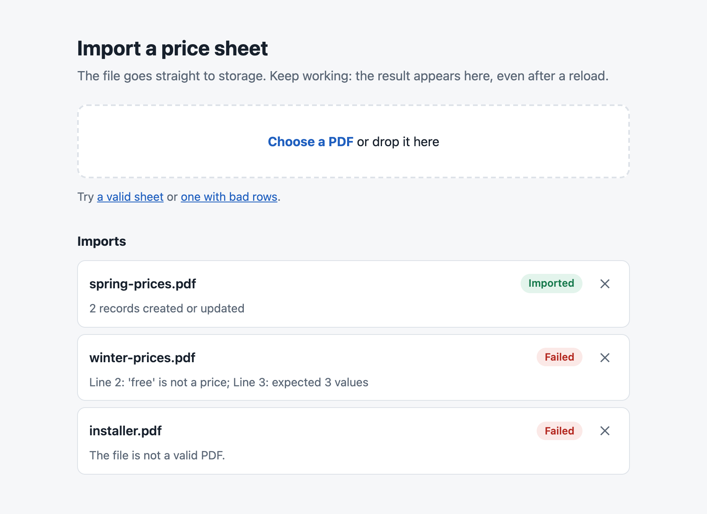
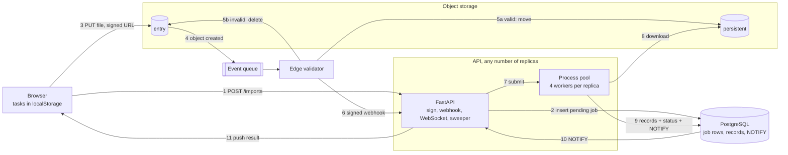
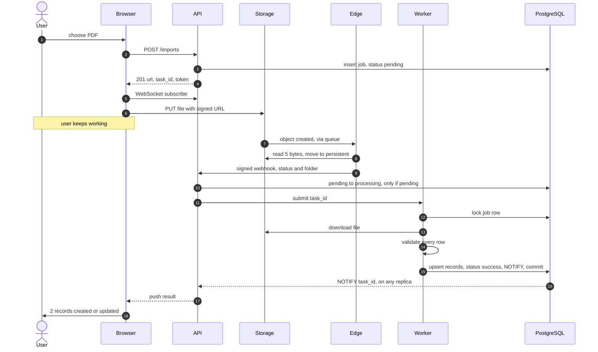
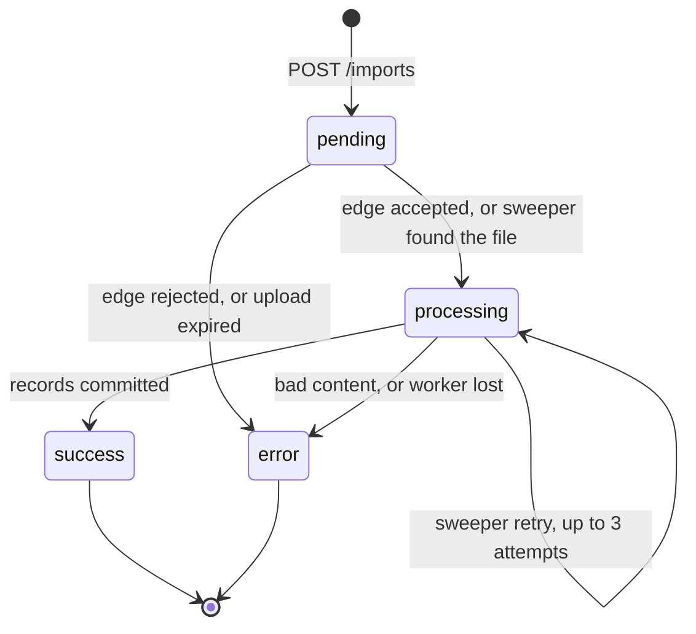
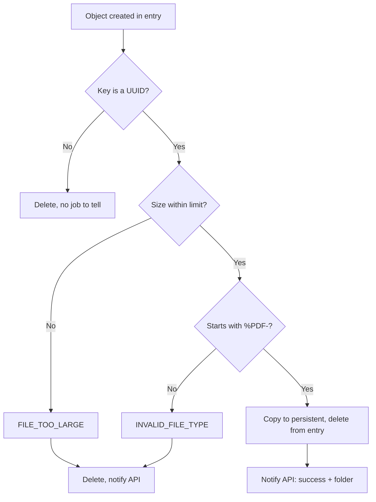
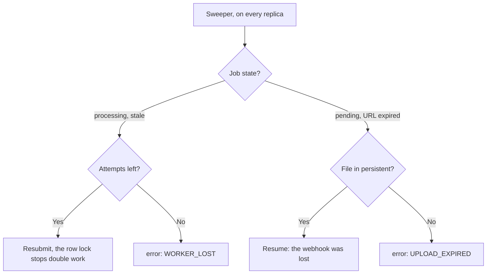

<div align="center">

# Async Import Pipeline

**Importing user files without carrying a single byte through the API request path.**



<sub>The web UI after three real imports against the local stack.</sub>

[](https://github.com/the3ma/async-import-pipeline/actions/workflows/ci.yml)

[](LICENSE)

[Quick start](#quick-start) · [Goals](#goals) · [Architecture](#architecture) · [How it works](#how-it-works) · [Wins](#wins) · [Limitations](#limitations) · [Docs](#documentation)

</div>

---

A browser uploads straight to object storage with a short-lived signed URL. A storage event starts validation at the edge, a worker pool turns the file into database records, and the result is pushed back over a WebSocket. The user keeps working the whole time.

It is the companion to [Async Export Pipeline](https://the3ma.github.io/async-export-pipeline/): that one moves data out, this one moves data in.

> Generalised from production work: the production original has run for two years. The client and product are not named, and the demo domain (price sheets) is invented. This is a new implementation, not the original code. It also fixes the original's known weaknesses: see [what changed](#limitations).

## Summary

| | |
|---|---|
| **Problem** | Parsing an uploaded file inside an HTTP request ties up the API for the whole upload and parse, and the user watches a spinner that dies with the connection. |
| **Approach** | Split the job into four stages that share only a UUID: sign, upload, validate, process. Job state lives in one database row, so any stage can fail and be recovered. |
| **Outcome** | The API only signs URLs and updates state. Bad files stop before the application. Results survive reloads, restarts and killed workers. |

## Quick start

Requires Docker with Compose v2 and [uv](https://docs.astral.sh/uv/).

```bash
git clone https://github.com/the3ma/async-import-pipeline.git
cd async-import-pipeline
make up     # API x2, edge validator, PostgreSQL, LocalStack (S3 + SQS)
make test   # unit tests, no Docker needed
make e2e    # acceptance tests against the running stack
make bench  # API cost and latency on your machine
make down
```

Open <http://localhost:8100>, and use the sample links on the page. `make help` lists every target.

## Goals

| Goal | How it is met | Proved by |
|---|---|---|
| Keep file bytes out of the API | Signed PUT, browser uploads to storage | `make bench` |
| Never block the user | Upload returns, result arrives by push | `test_result_is_pushed_to_a_subscriber_on_another_replica` |
| Reject bad input cheaply | Edge reads the size and 5 bytes | `test_executable_renamed_to_pdf_is_rejected_at_the_edge`, `test_oversized_file_is_rejected_at_the_edge` |
| Keep the API responsive during parsing | Separate worker processes | `make bench` |
| All-or-nothing imports | Validate all rows, then one transaction | `test_one_bad_row_writes_nothing` |
| Never strand a job | Database sweeper recovers or expires it | `test_job_abandoned_by_a_dead_worker_is_resumed`, `test_lost_webhook_is_recovered_from_storage`, `test_abandoned_upload_expires` |
| Survive crashes | Broken pool is replaced | `test_imports_keep_working_after_a_worker_process_is_killed` |
| Lose no result | Late subscribers read the job row | `test_late_subscriber_gets_the_result_from_the_database` |
| Refuse forged input | HMAC webhook, per-task tokens | `test_unsigned_webhook_is_refused`, `test_status_needs_the_task_token` |

**Non-goals:** resumable uploads, files above a few MB, per-row partial success, progress percentages.

### Failures this design removes

These are the failure modes of a synchronous import, not incidents from the original system.

| Symptom | Root cause | Fixed by |
|---|---|---|
| Upload times out at the gateway | File passes through API and ingress | Direct-to-storage signed URL |
| API slows for everyone during an import | CPU-bound parsing on the event loop | Separate worker processes |
| Junk files reach the parser | No check before processing | Edge validation |
| Half-imported file leaves partial records | Row-by-row commits | One transaction per file |
| User reloads and loses the result | Result tied to the open request | Durable job row, replay on subscribe |
| Two uploads collide on a filename | User-chosen storage key | Server-generated UUID key |
| A leaked upload link stays usable | Long-lived or broad credentials | Write-only, one object, 15 minutes |

## Who it serves

| Persona | Job | What they get |
|---|---|---|
| **Catalogue editor** | Load price sheets | Pick a file, carry on, see every problem in a bad file at once |
| **Operator** | Keep imports healthy | Machine-readable error codes, one row per job, self-healing jobs |
| **Developer** | Change the pipeline | The whole flow on one machine with one command, and no cloud account |

## Architecture



| Component | Here | Production original | Responsibility |
|---|---|---|---|
| Object storage | LocalStack S3 | Azure Blob Storage | Receives the upload, emits the event |
| Event delivery | S3 to SQS | Blob trigger | Tells the edge a file arrived |
| Edge validator | `importer.edge` | Azure Function | Size and type check, move or delete, call the webhook |
| API | FastAPI | FastAPI on AKS behind API Management | Signs URLs, owns job state, hosts the WebSocket |
| Workers | `ProcessPoolExecutor` | `multiprocessing.Pool` | Parse and write records |
| Job state | PostgreSQL table | PostgreSQL `JSONB` table | Single source of truth |
| Client | Plain JavaScript | Vue 3 + Pinia | Upload, subscribe, results list |

The layout is small on purpose:

```text
src/importer/
  api.py        HTTP, WebSocket, sweeper
  edge.py       storage events: validate, move, notify
  worker.py     one import, in its own process
  parser.py     PDF to validated records
  common.py     settings, storage client, signing
tests/          unit and end-to-end acceptance tests
docs/           contract, ADRs, production notes, page brief
```

## How it works

### The happy path



### Job states



Every transition out of `pending` is one atomic `UPDATE ... WHERE status = 'pending'`. That single condition makes duplicate webhooks harmless and stops replicas racing.

### Edge validation



The edge never downloads the file. It gets the size from the event and reads 5 bytes with a ranged request. If it crashes, the queue redelivers the event.

### Recovery

Nothing assumes a message arrives. The sweeper reads the job table, so every failure ends in the same place.



| Failure | What happens |
|---|---|
| Edge is down | Events wait in the queue |
| Webhook lost after all retries | Sweeper finds the moved file and resumes |
| Worker killed | Pool is replaced, sweeper resubmits |
| API restarts | Sweeper resubmits, and the browser reconnects and resubscribes |
| User abandons the upload | Job expires, and a lifecycle rule clears the entry bucket |
| Same event delivered twice | Second one finds no object, or no `pending` job |

### Crossing the process boundary

Connections cannot be pickled, so the API sends a worker only the task ID, and the worker builds its own clients. `worker.run` catches everything and always writes a final state. Results come back through the database, not through the process pool, which is why a push works from any replica.

## Decisions

Each one has a full record in [`docs/adr`](docs/adr).

| # | Decision | Result |
|---|---|---|
| [1](docs/adr/0001-direct-upload-with-signed-urls.md) | Signed URL, direct upload | API cost does not depend on file size |
| [2](docs/adr/0002-filename-is-the-correlation-id.md) | The filename is the task UUID | No lookup table, no user input in storage keys |
| [3](docs/adr/0003-edge-validation-before-the-application.md) | Validate before the application | Junk costs 5 bytes of reading, not a worker slot |
| [4](docs/adr/0004-process-pool-with-a-database-sweeper.md) | Process pool plus sweeper, no broker | Durable jobs without another system to run |
| [5](docs/adr/0005-websocket-push-backed-by-the-job-row.md) | Push backed by the job row | Multi-replica without Redis |
| [6](docs/adr/0006-one-transaction-per-file.md) | One transaction per file | No partial imports, safe reruns |
| [7](docs/adr/0007-signed-webhook-and-task-tokens.md) | Signed webhook, task tokens | Results cannot be forged or read by ID alone |

### Trade-offs

| Chose | Instead of | The cost |
|---|---|---|
| In-process pool + sweeper | Celery, Service Bus | Workers scale only with API replicas |
| Postgres `NOTIFY` | Redis pub/sub | A missed notification waits for the next subscribe |
| WebSocket push | Polling | Stateful connections through the gateway |
| One transaction per file | Per-row commits | One bad row fails the whole file |
| Edge validator | Validate in the worker | One more deployable |
| Fixed sheet format | Free-form extraction | Reliable and cheap, but a format change needs code |

## Wins

**Measured** with `make bench`: 20 runs per size against LocalStack. These show the shape, not production capacity. The padded test files have two rows, so they measure moving bytes, not parsing large sheets.

| File size | API call p50 | End-to-end p50 | End-to-end p95 |
|---|---|---|---|
| 2 KB | 6 ms | 0.04 s | 0.10 s |
| 1 MB | 6 ms | 0.05 s | 0.08 s |
| 5 MB | 6 ms | 0.17 s | 0.23 s |

- **API cost is flat.** The API call takes 6 ms at every size, because the file never touches it.
- **The API stays responsive.** Its p95 was 5.3 ms idle and 11.8 ms during 40 imports of 5 MB, 8 at a time.

**By design:**

- **Self-healing jobs.** Every job ends in a final state, whatever fails.
- **Idempotent at every step.** Duplicate events, webhooks and worker runs are harmless.
- **Least-privilege upload.** The URL is write-only, for one object, for 15 minutes.
- **Useful errors.** A bad file reports every failing line at once.
- **Reload-proof.** Results survive reloads and API restarts. This was checked in a real browser, with the edge stopped and the API restarted mid-import.

### System figures

| Setting | Value | Why |
|---|---|---|
| Signed URL lifetime | 900 s | Long enough for a slow upload, short enough to limit a leak |
| Max file size | 5,120,000 bytes | Sheets are small |
| Workers | 4 per replica | CPU-bound parsing |
| Webhook retries | 3 attempts, 30 s timeout, 1 s and 2 s backoff | Rides out an API restart |
| Worker attempts | 3 | Then `WORKER_LOST`, so a poison file cannot loop forever |
| Sweeper | Every 30 s, stale after 120 s | Compose uses 2 s and 5 s so tests are quick |

## Limitations

**Still open in this repo:**

| Limitation | Impact | Next step |
|---|---|---|
| No user authentication | Task tokens are capabilities, and anyone can start an import | Add auth and tie jobs to users |
| No malware scan | Only the signature is checked, and files then reach `pdfplumber` | Scan in storage, sandbox the parser |
| Size is checked after upload | A signed PUT cannot cap size, so oversized files reach storage before rejection | S3 POST policies can cap it. Azure SAS cannot |
| All-or-nothing per file | One bad row rejects the file | By design, with every error reported at once |
| Fixed sheet format | Any format change needs code | Version the format |
| Workers tied to API replicas | Heavy parsing competes for the same CPU | Move workers to their own service |
| One database connection per call | Fine for a demo, not for high request rates | `psycopg_pool` |
| Long jobs retried while running | A job longer than the stale timeout gets resubmitted. The row lock prevents double work, but a pool slot waits | Set `STALE_SECONDS` above the longest import |
| Tested on LocalStack only | Cloud behaviour may differ, and this repo has not run on AWS or Azure | See [production notes](docs/PRODUCTION.md) |

**What changed from the production original:**

| Original limitation | Status here |
|---|---|
| Subscribers and results in process memory, one replica only | **Fixed:** job row plus `NOTIFY`, tested across 2 replicas |
| Jobs lost on restart | **Fixed:** sweeper resubmits |
| Abandoned uploads stayed `pending` forever | **Fixed:** expiry and lifecycle rule |
| A lost webhook left a job stuck | **Fixed:** sweeper recovers from storage |
| No status endpoint | **Fixed:** `GET /imports/{id}` |
| Client lost subscriptions on reconnect | **Fixed:** resubscribes on every open |
| Whole file read into edge memory | **Fixed:** 5-byte ranged read |
| Unsigned webhook, task ID as the only credential | **Fixed:** HMAC and task tokens |
| Cloud-only validation path | **Fixed:** the edge runs locally too |
| First error stopped the report | **Fixed:** all errors reported at once |
| Blob trigger latency not guaranteed | **Changed:** queue-based delivery |

## Documentation

| Doc | What it covers |
|---|---|
| [Contract](docs/CONTRACT.md) | API, WebSocket, webhook, error codes, configuration |
| [ADRs](docs/adr) | The seven decisions, with context and consequences |
| [Production notes](docs/PRODUCTION.md) | AWS and Azure mapping, checklist, lessons |
| [Page brief](docs/PAGE-BRIEF.md) | How to build the case-study page from this repo |

## License

[MIT](LICENSE)
